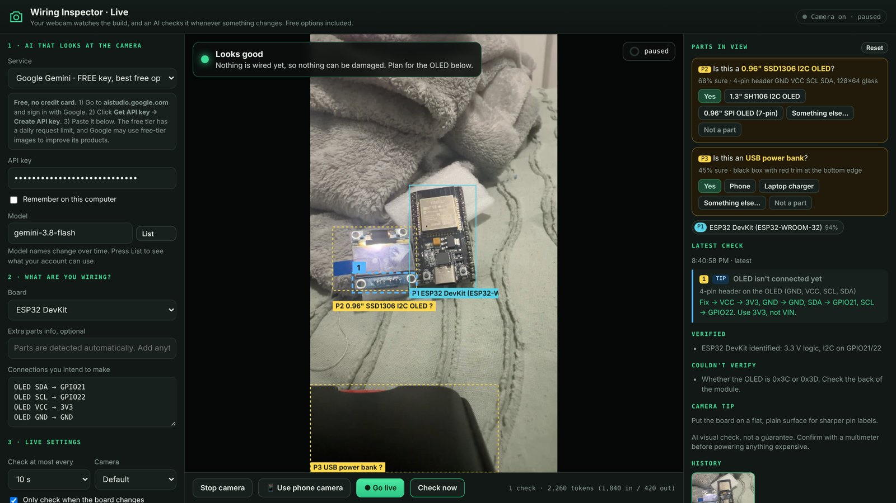
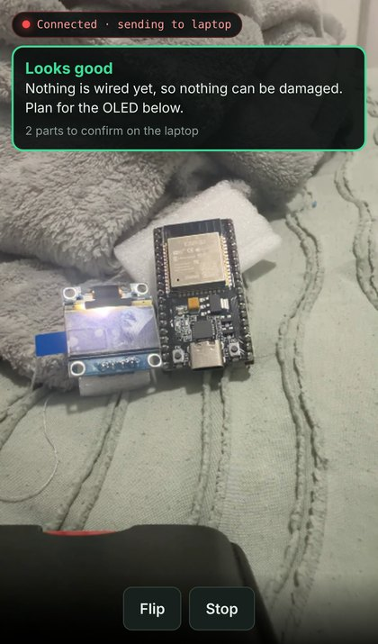
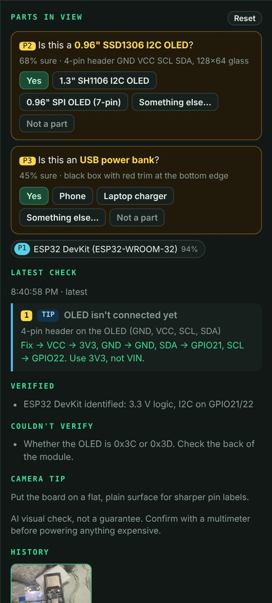
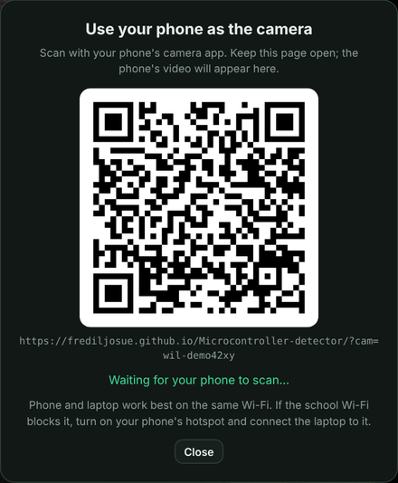
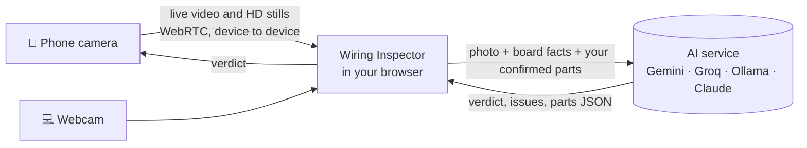

<div align="center">

# 🔌 Microcontroller Detector · Live Wiring Inspector

**Point a camera at your breadboard. An AI names the parts, checks the wiring, and tells you if it's safe to power on.**

[**▶ Open the app**](https://frediljosue.github.io/Microcontroller-detector/) · [Getting started](docs/getting-started.md) · [Phone camera](docs/phone-camera.md) · [Free AI options](docs/ai-services.md) · [Troubleshooting](docs/troubleshooting.md)

[](https://github.com/frediljosue/Microcontroller-detector/actions/workflows/tests.yml)




</div>

## Why

Wiring mistakes kill boards: 5 V into a 3.3 V pin, an LED with no resistor, a servo powered from a GPIO pin, one row off on the breadboard. Most of them are easy to see if someone experienced is looking over your shoulder. This app is that second pair of eyes. It watches while you build and warns you **before** you plug in power.

## Features

- 🎥 **Live checking.** Watches the camera and runs a check whenever the board changes and your hands are out of the way.
- 🚦 **Clear verdicts.** *Looks good*, *Check before powering*, or ***Do NOT power on***, with numbered boxes on the video and a concrete fix for every issue.
- 🔍 **Automatic part detection.** Names the parts it sees, like an *ESP32 DevKit* or a *0.96" SSD1306 OLED*, and **asks you to confirm when it isn't sure**. Your answers are treated as fact on every later check.
- 📱 **Phone as a wireless camera.** Scan a QR code and your phone streams to the laptop. For each check, the phone also sends a full-resolution photo, so small labels and resistor bands are readable.
- 🆓 **Free AI options.** Google Gemini and Groq have free keys. Ollama runs on your own laptop, offline, with no key at all. Anthropic Claude is supported if you have credits.
- 🧠 **Knows your board.** Built-in facts for Arduino Uno, Nano and Mega, ESP32, ESP8266, XIAO ESP32-C3, Raspberry Pi Pico and STM32 Blue Pill, such as logic voltage, 5 V tolerance, I2C and SPI pins, and boot-pin traps.
- 🔊 **Spoken warnings, vibration and history.** Hear "Stop. Do not power on." without looking up. Every check is saved as a thumbnail you can click back to.
- 🔒 **Private by design.** One HTML file, no server, no account. Your API key never leaves your browser except to go to the AI service you picked.

## Quick start

1. **Get a free Gemini key.** Go to [aistudio.google.com](https://aistudio.google.com), sign in, and click **Get API key → Create API key**.
2. **Open the app** at **[frediljosue.github.io/Microcontroller-detector](https://frediljosue.github.io/Microcontroller-detector/)** in Chrome or Edge on a laptop.
3. **Paste the key** into **API key** and pick your **Board**.
4. **Start the camera.** Click **Start camera** for the laptop webcam, or **📱 Use phone camera** and scan the QR code.
5. Press **Go live**. Build as normal. Answer the yellow *"Is this a …?"* cards when they appear.

The full walkthrough with every setting is in **[docs/getting-started.md](docs/getting-started.md)**.

## Screenshots

| Phone as the camera | Part questions | Pairing |
|:---:|:---:|:---:|
|  |  |  |

## Which AI service should I use?

| Service | Cost | Setup | Best for |
|---|---|---|---|
| **Google Gemini** | Free key, daily limit | 1 min | Most people. Best free accuracy |
| **Groq** | Free key, daily limit | 1 min | Speed |
| **Ollama** | Free, unlimited, offline | ~15 min | Privacy, labs with bad internet, no limits |
| OpenRouter or any OpenAI-compatible API | Has `:free` models | 2 min | Trying other models |
| **Anthropic Claude** | Paid credits | 2 min | Highest accuracy |

Step-by-step setup for each one is in **[docs/ai-services.md](docs/ai-services.md)**.

## How it works



1. A tiny 40×30 grayscale copy of every frame is compared with the last one, to notice **when something changed** and **when your hands are out of the way**.
2. Then one photo goes to the AI, together with facts about your board, the connections you intended, and the parts you already confirmed.
3. The AI answers in a fixed JSON format. The app draws the boxes, updates the parts list, and speaks warnings.

The technical details are in **[docs/how-it-works.md](docs/how-it-works.md)**.

## Privacy and safety

- **Your API key** is typed into your own browser and sent only to the AI service you chose. It is never in this repo. "Remember" stores it in that browser only, so leave it off on shared computers.
- **Photos** go to the AI service you chose. Google may use **free-tier** Gemini content to improve its products. With **Ollama**, nothing leaves your laptop.
- **Phone video** goes directly between your phone and laptop. PeerJS's public server only helps them find each other.
- **The AI can be wrong.** It can't see under parts or inside wires, and it may misread small labels. Treat it as a careful friend, not a guarantee. **Check with a multimeter** before powering anything expensive.

## Project layout

```
index.html              the whole app: one file, no build step
docs/                   guides and screenshots
tests/                  offline browser tests: Playwright + pytest
.github/workflows/      runs the tests on every push
```

## Development

There's nothing to build. Edit `index.html` and refresh. To run the tests:

```bash
cd tests && npm install && pip install -r requirements.txt
python -m playwright install chromium && python -m pytest -v
```

See [CONTRIBUTING.md](CONTRIBUTING.md) for ideas and guidelines.

## Roadmap

- [ ] Show how long each check took
- [ ] Always ask about power parts like regulators and buck converters, whatever the confidence
- [ ] Export a wiring report as a PDF for lab write-ups
- [ ] Schematic overlay: draw the expected connections on top of the video
- [ ] Works-offline mode with a small in-browser vision model

## Credits

Built by **[Fredil Martinez](https://github.com/frediljosue)**, Robotics Club, Miami Dade College · Padrón Campus, with help from Claude.
Uses [PeerJS](https://peerjs.com/) for the phone link and [qrcode-generator](https://github.com/kazuhikoarase/qrcode-generator) for the QR code.

## License

[MIT](LICENSE). Use it, change it, share it.
