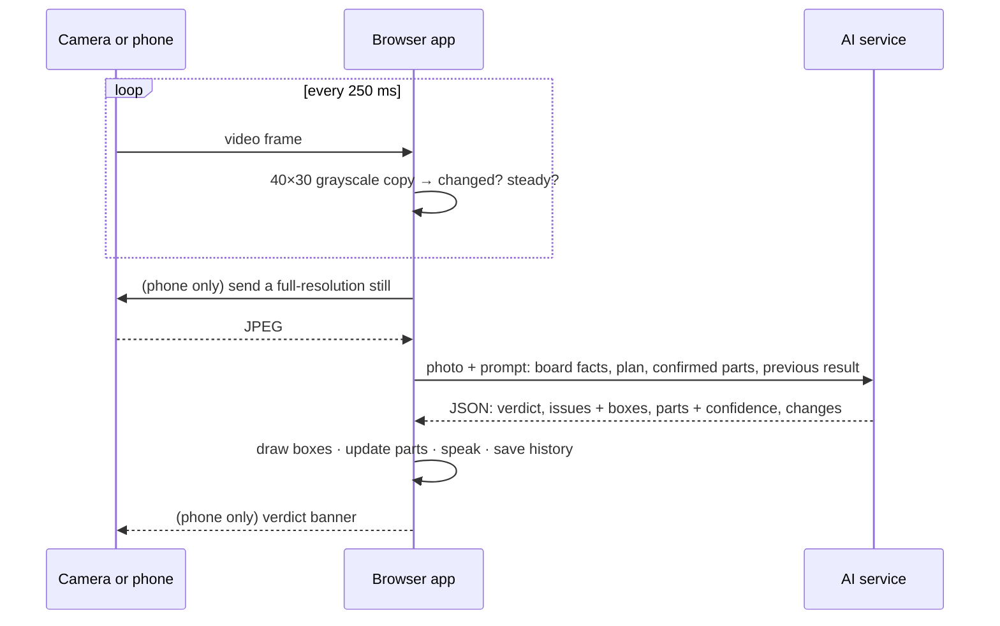

# How it works

The whole app is one file, `index.html`: HTML, CSS and plain JavaScript, with no framework and no build step. This page explains the main ideas so you can change it confidently.

## The big picture



## 1 · Deciding when to check

Sending every frame would be slow and would burn through free limits, so the app only checks when it's worth it.

- Every 250 ms a frame is shrunk to **40×30 grayscale**, which is 1,200 numbers.
- **Motion** is the average difference from the previous tiny frame. **Change** is the difference from the frame at the last check.
- **Adaptive steadiness.** The app keeps the last ~6 s of motion values and takes a low percentile as the camera's normal *jitter*. A frame counts as steady when motion is below `max(3.2, jitter × 1.6 + 1.5)`. That way a hand-held phone isn't "moving" forever, but a hand entering the picture still is.
- A check runs when the picture **changed**, has been **steady for ~1 s**, and the minimum interval has passed. If it never becomes steady, it checks anyway after **6 s**.

## 2 · The prompt

`prompt()` builds the instructions sent with each photo:

- **Role and honesty rules.** A senior engineer doing a pre-power inspection, who must only claim what is actually visible.
- **Board facts** from the `BOARDS` table: logic voltage, 5 V tolerance, I2C and SPI pins, gotchas like *GPIO6–11 are flash* on the ESP32.
- **Your intended connections** and **extra parts info**.
- **Parts memory.** Parts you confirmed, which are treated as fact; parts it found before; and things you said aren't parts.
- **The previous result**, so it can report what *changed*, like "fixed: LED polarity".
- **A strict JSON format** to answer in.

```json
{
  "verdict": "ok | warning | danger | unclear",
  "summary": "…", "safe_to_power": true,
  "issues": [{"severity": "critical | warning | tip", "title": "…", "where": "…", "fix": "…", "box": [x0, y0, x1, y1]}],
  "changes": ["…"], "looks_correct": ["…"], "could_not_verify": ["…"], "better_photo_tips": "…",
  "parts_detected": [{"name": "…", "type": "…", "confidence": 0.0, "clue": "…", "alternatives": ["…"], "box": [x0, y0, x1, y1]}]
}
```

Boxes are **normalized** from 0 to 1, so they're drawn correctly at any video size. The reply is parsed by taking everything between the first `{` and the last `}`, which tolerates code fences or chatty extras.

## 3 · One adapter per AI service

`callAI(image, prompt)` is the only function that knows about specific services. Each branch packs the image the way that API expects and returns the same three things: `{text, tin, tout}`, meaning the reply text, input tokens and output tokens.

| Service | Image format | JSON mode |
|---|---|---|
| Anthropic | `{type:"image", source:{type:"base64", …}}` | prompt only |
| Gemini | `{inline_data:{mime_type, data}}` | `responseMimeType: "application/json"` |
| Ollama | `images: [base64]` | `format: "json"` |
| Groq / OpenAI-compatible | `{type:"image_url", image_url:{url:"data:…"}}` | prompt only |

To add a service, add an entry to `PROVIDERS` and one `else if` in `callAI`.

**Errors.** 429 means you sent too much, and 503 means the service is busy. They are handled differently in `runCheck`. Quota problems move down the model list. Overloads try the next model once each, then back off using `onRateLimit()`. Any `retryDelay` the service suggests is respected.

## 4 · Parts memory

The AI has no memory between checks, so the app keeps it:

```
parts: key → {name, type, conf, clue, alts, box, status: auto | pending | you | ignored, seen}
alias: "name the AI used" → key
```

- A new part with confidence below your threshold becomes **pending**, which shows a question card. That decision is made in `needsConfirmation(p)`.
- If you rename "blue module" to "DHT11", the **alias** maps the old name to the same part. If the AI keeps saying "blue module", it still matches.
- Your answers go back into the prompt as facts, and they're saved in `localStorage` under `wil.partsState`.

## 5 · Phone link

- The laptop creates a [PeerJS](https://peerjs.com/) peer with a random ID like `wil-3pq067rs`. The QR code is the online page address plus `?cam=<id>`.
- The same `index.html` opened with `?cam=` switches into **phone mode**. It hides the main app and shows a full-screen camera.
- The phone opens a **data connection** and a **video call** to the laptop. After PeerJS's server introduces them, the video flows **directly** between the devices over WebRTC.
- Data messages: `snapReq` and `snap` carry the full-resolution still for each check, `verdict` carries the banner, and `bye` disconnects.
- The phone asks WebRTC for 4 Mbit/s with `maintain-resolution` and keeps the screen awake with the Wake Lock API.

## 6 · Code map

Sections in `index.html`, top to bottom:

| Section | What's there |
|---|---|
| `<style>` | Theme variables, layout, phone layout under 760 px, phone-mode styles |
| Board knowledge | `BOARDS` |
| AI services | `PROVIDERS`, model listing, settings saving |
| Camera | `startCam`, `useStream`, `stopCam` |
| Change detection | `thumb`, `diff`, the 250 ms main loop |
| AI call | `frameJpeg`, `prompt`, `callAI`, `onRateLimit`, `runCheck` |
| Voice | `alertIfNeeded` |
| Parts | `needsConfirmation`, `mergeParts`, `partsForPrompt`, `answerPart`, `renderParts` |
| Rendering | `render`, `drawOverlay` with labels that avoid overlapping |
| Phone link, laptop side | `openPhone`, `showQR`, `getFrame`, `tellPhone` |
| Phone mode | A second `<script>` that only runs when the URL has `?cam=` |

## Good first changes

- **`needsConfirmation(p)`.** Always ask about `p.type === 'power'` parts, since a misread regulator means the wrong voltage.
- **`onRateLimit(provider, hits)`.** Turn live mode off after several daily-limit hits in a row.
- **`BOARDS`.** Add your board: Teensy, Arduino Nano ESP32, Raspberry Pi Zero.
