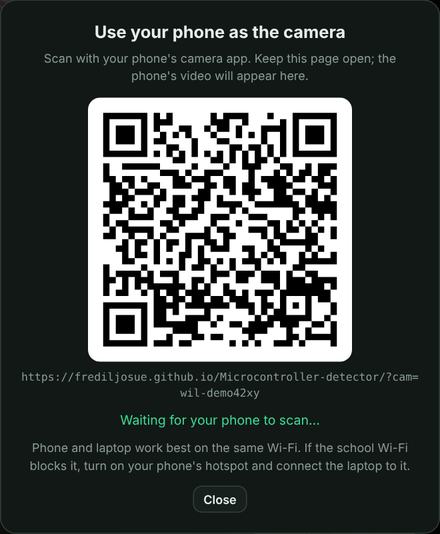
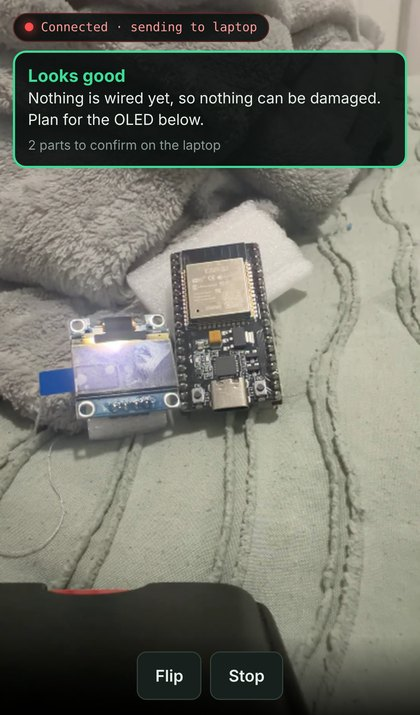

# Use your phone as the camera

Your phone streams live video to the laptop. The laptop runs the AI checks and shows the full results, and the phone shows the verdict.

  
  &nbsp;&nbsp;
  

## Connect

1. On the laptop, open the app from **[frediljosue.github.io/Microcontroller-detector](https://frediljosue.github.io/Microcontroller-detector/)**.
2. Click **📱 Use phone camera**. A QR code appears.
3. Scan it with your phone's normal camera app and open the link.
4. Tap **Start camera** and allow camera access.
5. The phone's video appears on the laptop within a few seconds. Press **Go live**.

## Phone buttons

| Button | Does |
|---|---|
| **Flip** | Switches between the back and front camera |
| **Light** | Turns the flashlight on or off. Most Android phones support this; iPhones usually don't allow it from a web page |
| **Stop** | Stops the camera and disconnects. The laptop notices and tells you |

While connected, the phone keeps its screen on. It shows the latest verdict, any critical issues, and how many parts are waiting to be confirmed on the laptop. On **Do NOT power on**, Android phones vibrate.

## Why the photos are sharper than the video

Live video is compressed and its quality drops when Wi-Fi is busy. So for every check, the laptop asks the phone for a **separate full-resolution photo**, 1600 px on the long side, and sends that to the AI. If the phone doesn't answer within 3.5 s, the video frame is used instead.

## Mounting the phone

- A cheap **phone stand**, **gooseneck clamp** or **overhead tripod arm** is ideal. Aim straight down.
- Keep the phone **20–35 cm** above the board, so the whole breadboard fills the picture.
- Light the board from the side to avoid glare on OLED screens and shiny chips.

## Requirements and limits

- **The phone must open the online `https://` copy.** Phones only allow the camera on secure pages. If you open the app on the laptop from a downloaded file, it asks for the online address once and remembers it.
- **Same Wi-Fi works best.** The video goes **directly** between the devices. Many **school and campus networks block this.** If it's stuck on *Waiting for your phone to scan…* or the phone says *Connecting…* forever, turn on your **phone's hotspot** and connect the laptop to it.
- **Ollama works with the phone camera.** The AI runs on the laptop, and the phone is only the camera.

## Privacy

The video and photos travel **phone → laptop** directly over WebRTC, encrypted. The free [PeerJS](https://peerjs.com/) server only passes the "here I am" messages that let the two devices find each other. It never sees the video.

Next: [AI services →](ai-services.md)
